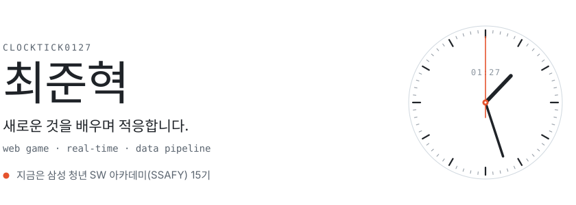
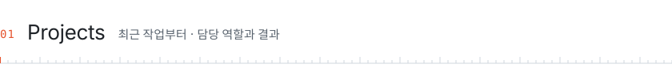
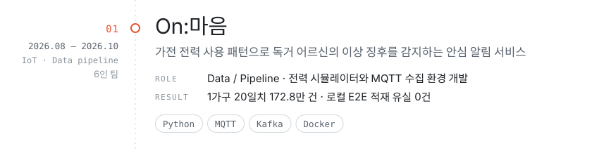
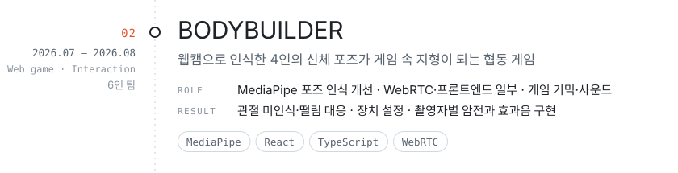
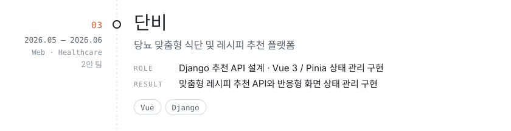
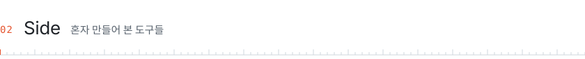
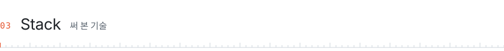
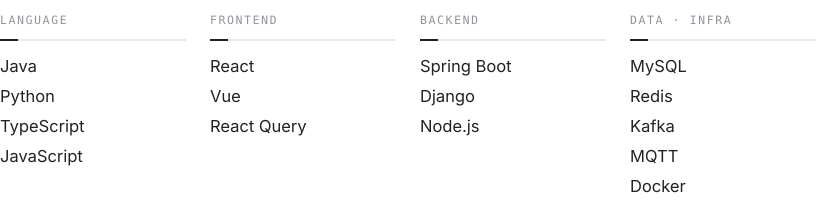

<a href="https://clocktick0127.github.io/">
  <picture>
    <source media="(prefers-color-scheme: dark)" srcset="assets/header-dark.svg">
    
  </picture>
</a>

직접 만들고, 문제를 풀며 배운 작업들을 모았습니다. 
웹캠 포즈가 지형이 되는 협동 게임부터 가전 전력 파형을 읽는 IoT 서비스까지, 팀 프로젝트로 만들어 왔습니다.

**[포트폴리오 ↗](https://clocktick0127.github.io/)** &nbsp;·&nbsp; **[개발 기록 ↗](https://clocktick0127.tistory.com/)** &nbsp;·&nbsp; **[메일 ↗](mailto:clocktick0127@gmail.com)**

 

<picture>
  <source media="(prefers-color-scheme: dark)" srcset="assets/section-projects-dark.svg">
  
</picture>

<!-- projects:start -->

<a href="https://github.com/ClockTick0127/PJT_On-Maeum"><picture>
  <source media="(prefers-color-scheme: dark)" srcset="assets/project-01-dark.svg">
  
</picture></a>
<a href="https://youtu.be/OHdWT9M85hU"><picture>
  <source media="(prefers-color-scheme: dark)" srcset="assets/project-02-dark.svg">
  
</picture></a>
<a href="https://github.com/ClockTick0127/FJT"><picture>
  <source media="(prefers-color-scheme: dark)" srcset="assets/project-03-dark.svg">
  
</picture></a>

<!-- projects:end -->

 

<picture>
  <source media="(prefers-color-scheme: dark)" srcset="assets/section-side-dark.svg">
  
</picture>

- **[LifeKit](https://github.com/ClockTick0127/Todo_Tool)** — 상황별 실행 순서와 준비·제출 목록을 만들고 따라가는 로컬 전용 데스크톱 앱 &nbsp;`Electron` `TypeScript`
- **[게임 캘린더](https://github.com/ClockTick0127/Game_C)** — RAWG·Steam 데이터로 게임 출시일을 월간 캘린더에 모아 보는 웹 서비스 &nbsp;`React` `Node.js`
- **[folio](https://github.com/ClockTick0127/Test_PJT2)** — 경험을 근거로 공고와 매칭하고 포트폴리오를 엮는 취업 준비 작업실 &nbsp;`Next.js` `Supabase`

 

<picture>
  <source media="(prefers-color-scheme: dark)" srcset="assets/section-stack-dark.svg">
  
</picture>

<picture>
  <source media="(prefers-color-scheme: dark)" srcset="assets/stack-dark.svg">
  
</picture>

<!-- projects:start~end 사이와 assets/ 는 GitHub Actions가 scripts/build.py 로 매일 다시 만듭니다.
     프로젝트는 포트폴리오 사이트의 projects.json 에서, 프로필 문구·스택은 build.py 의 DATA 영역에서 고치세요. -->
